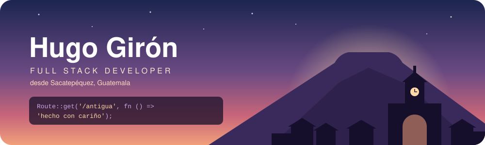

  
  
  
  

Soy **desarrollador full stack**. Construyo el backend, las pantallas que lo
usan y la base de datos que lo sostiene. Actualmente hago mi práctica
profesional supervisada en la **Biblioteca Central de la USAC**, donde
desarrollo módulos de un sistema que usan a diario el personal y los usuarios
de la biblioteca más grande de la universidad.

Me interesa que el software funcione bien cuando alguien real lo necesita:
reservas que no se traslapan, inventarios que cuadran, procesos que se
automatizan sin romper nada.

Estudio **Ingeniería en Ciencias y Sistemas** en la Universidad de San Carlos
de Guatemala (cierre de pensum: junio 2026).

## 🛠️ &nbsp;Con qué trabajo

**Backend**

  
  
  
  
  

**Bases de datos**

  
  
  
  
  

**Frontend**

  
  
  

**Herramientas e infraestructura**

  
  
  
  
  
  

## 📚 &nbsp;SABIC — Sistema de Administración de Biblioteca Central

Práctica profesional supervisada · Biblioteca Central, USAC · Feb 2026 – Actualidad

Trabajo en un equipo que desarrolla el sistema administrativo de la biblioteca.
Me encargo de construir funcionalidades completas, de backend y frontend, en
varios módulos.

<b>🧩 &nbsp;Módulos en los que trabajo</b>

 

| Módulo | Qué resuelve |
|---|---|
| Correlativos de Oficios | Numeración secuencial automática de oficios |
| Reservas de Espacios | Reservas, con bloqueos automáticos por inasistencia |
| Usuarios | Gestión de usuarios y autenticación de dos factores |
| Inventario | Verificación de inventario mediante códigos QR |
| Gestión de Lockers | Control y asignación de lockers |

<b>⚙️ &nbsp;Cómo trabajo</b>

 

- Arquitectura de tres capas con **MVC**: **Laravel** para la lógica de negocio
  y **Filament** para los paneles administrativos.
- Diseño y optimizo esquemas relacionales en **MySQL**, cuidando la integridad
  referencial entre módulos y la consistencia de las transacciones críticas
  (reservas, préstamos, inventario).
- Uso **Git y GitHub** en un repositorio compartido, con ramas por módulo y
  revisión de cambios para evitar conflictos entre integrantes.
- Uso asistentes de IA para generar código, depurar y explorar código
  existente, y siempre valido y ajusto el resultado antes de llevarlo a
  producción.
- Documento los procesos técnicos y elaboro manuales de usuario para capacitar
  al personal bibliotecario.

## 🎓 &nbsp;Además

- **Auxiliar de cátedra** (2023 – 2024), Prácticas Intermedias, USAC: impartí
  el laboratorio, diseñé prácticas y proyectos, califiqué y asesoré a
  estudiantes en el desarrollo de sus proyectos de software.

## ✨ &nbsp;Contacto

Abierto a oportunidades como desarrollador **full stack** o **backend**.

  

<!--
NOTAS (borra este bloque antes de publicar):
Sube README.md y la carpeta "assets" (banner.svg y divider.svg) al repositorio.
Cuando tengas proyectos propios, agrega una sección "Proyectos" con enlaces a tus repositorios.
-->
